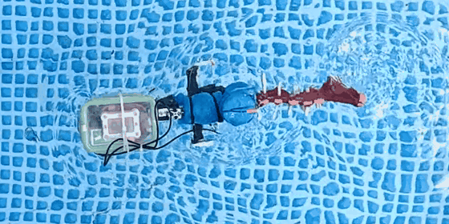
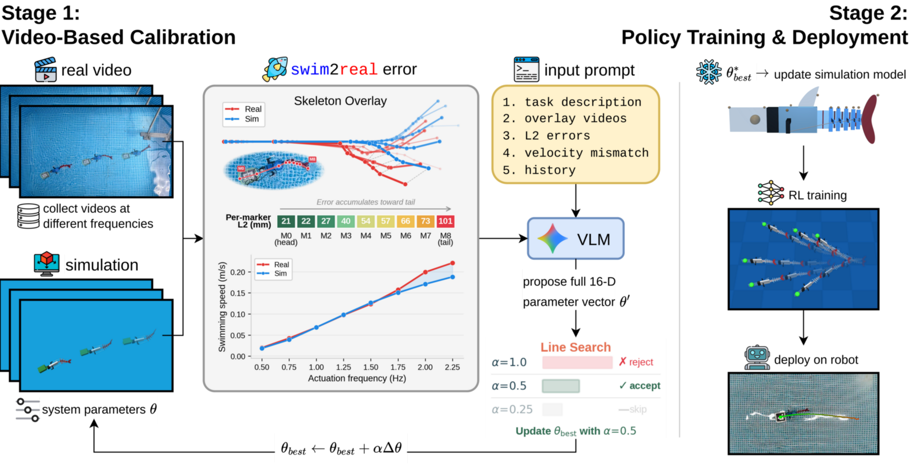
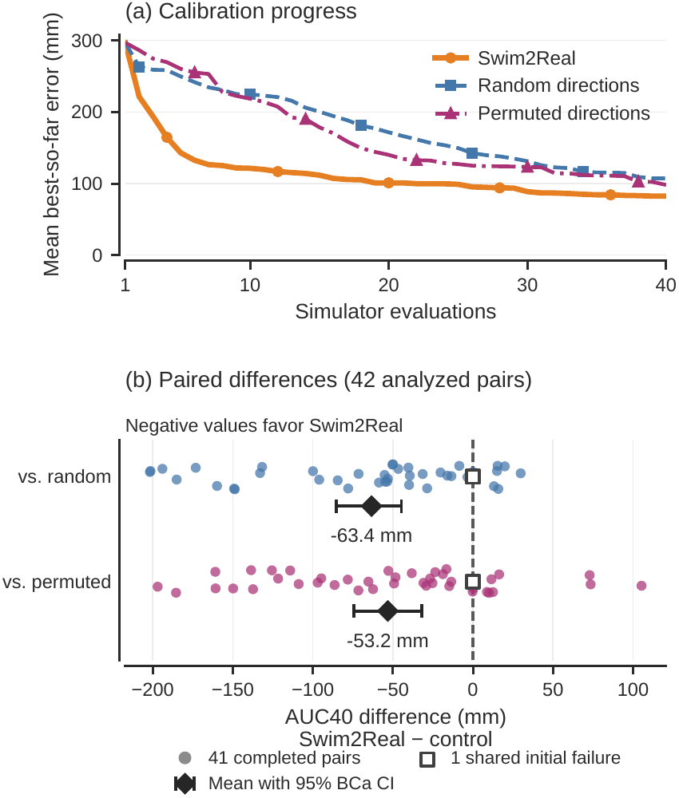

# Swim2Real: Vision-Language Models for Simulator Calibration of a Soft Robotic Fish

[](https://doi.org/10.1109/LRA.2026.3752343)
[](https://arxiv.org/abs/2603.20827)
[](https://swim2real.github.io)
[](https://github.com/kevinxqiu/swim2real/releases/tag/v1.0.0)
[](https://github.com/kevinxqiu/swim2real/actions/workflows/ci.yml)
[](LICENSE)
[](dataset/README.md)
[](pyproject.toml)

Kevin Qiu<sup>1</sup>, Kyle Liam Walker<sup>2,3</sup>, Mike Yan Michelis<sup>4</sup>, Marek Cygan<sup>1</sup>, Josie Hughes<sup>2</sup><br>
<sup>1</sup>University of Warsaw, <sup>2</sup>EPFL, <sup>3</sup>University of Liverpool, <sup>4</sup>ETH Zurich<br>
IEEE Robotics and Automation Letters, 2026

**Swim2Real** calibrates the simulator of a soft robotic fish from swimming
videos. A vision-language model (VLM) watches real and simulated swimming side
by side, reads the marker errors, and proposes updates to the 16 simulator
parameters. A backtracking line search tries each proposal at the full, half
and quarter step and keeps the first step that lowers the marker error, all
within 40 simulator evaluations.

<p align="center">
  
</p>
<p align="center"><i>The robotic fish swimming at a 1.5 Hz drive, filmed from above.</i></p>

## Highlights

- **The VLM proposes useful directions.** In an independent, preregistered
  fifty-seed replication, Swim2Real lowers the mean best-so-far marker error
  over 40 simulator evaluations by 63.4 mm against random directions and
  53.2 mm against signed-permuted directions under the same line search and
  budget. Both paired comparisons pass Holm correction (p < 10⁻⁵) on the
  common subset of 42 paired seeds.
- **A second VLM agrees.** A 24-seed experiment with GLM-5.3 Flash supports the
  same direction effect.
- **Few model calls.** With backtracking, a run needs 16.1 VLM proposals on
  average.
- **From simulation to the robot.** Ten open-loop hardware trials execute
  simulator-generated motor commands.

This repository holds the calibration code, the analysis code and the run
records. One CPU command recomputes the paper's calibration results from the
released records in a few seconds, with no simulator, videos or API key.

## Contents

- [Installation](#installation)
- [Recompute the paper's numbers](#recompute-the-papers-numbers)
- [Run a calibration](#run-a-calibration)
- [How it works](#how-it-works)
- [Run records](#run-records)
- [Repository structure](#repository-structure)
- [Citation](#citation)

## Installation

The analysis runs on a CPU with Python 3.10 or newer.

```bash
git clone https://github.com/kevinxqiu/swim2real
cd swim2real
python3 -m venv .venv && . .venv/bin/activate
pip install -e .                          # analysis and the toy demo
pip install -e '.[sim,vlm,baselines]'     # calibration: MuJoCo, VLM clients, BO and CMA-ES
```

## Recompute the paper's numbers

Download the run records from
[release v1.0.0](https://github.com/kevinxqiu/swim2real/releases/tag/v1.0.0)
and check them:

```bash
gh release download v1.0.0 -R kevinxqiu/swim2real -p runs.zip -p SHA256SUMS
sha256sum -c SHA256SUMS
swim2real reproduce --records runs.zip --out-json numbers.json --out-md numbers.md
swim2real check-numbers numbers.json
# prints a JSON report: 3212 values matched, 0 differing
```

`reproduce` recomputes every calibration result in the paper from the run
records in a few seconds, and `check-numbers` compares each value with
[`records/paper_numbers.json`](records/paper_numbers.json), which gives its
definition, where the paper reports it and the printed value.
[`records/paper_numbers.md`](records/paper_numbers.md) lists them all. The main
results are stored under these keys:

| Result | Paper | Value | Key |
| --- | --- | --- | --- |
| Mean AUC40 difference, Swim2Real minus random directions (42 pairs) | Table III | −63.36 mm [−85.29, −44.74] | `replication.primary.random.mean_delta_mm` |
| Mean AUC40 difference, Swim2Real minus signed-permuted directions | Table III | −53.17 mm [−74.22, −32.12] | `replication.primary.permuted.mean_delta_mm` |
| Holm-adjusted p-value, against random and against permuted directions | Table III | 1.2 × 10⁻⁷ and 7.9 × 10⁻⁶ | `replication.primary.random.holm_p`, `replication.primary.permuted.holm_p` |
| VLM proposals per run, Swim2Real | Table II | 16.1 | `fifteen_seed.arms.full_vlm_ls.proposals.mean` |

AUC40 is the mean best-so-far marker error over the first 40 simulator
evaluations. Brackets are 95% BCa intervals over seeds.

## Run a calibration

Try the loop first with the built-in toy swimmer, which needs no simulator,
data or API key:

```bash
swim2real calibrate --simulator toy --method multiscale_random_ls --seed 1248 \
    --budget 12 --output runs/demo
```

A real calibration needs four things the repository does not ship: the
fishCREATE simulator of the fish (see [THIRD_PARTY_NOTICES.md](THIRD_PARTY_NOTICES.md)),
the pool recordings described by a dataset manifest (see
[`configs/dataset.example.json`](configs/dataset.example.json)), a Gemini API
key, and [FFmpeg](https://ffmpeg.org) with libx264 on the `PATH`, which encodes
the overlay clips sent to the VLM (`sudo apt install ffmpeg` or
`brew install ffmpeg`). A run configuration such as
[`configs/example_run.json`](configs/example_run.json) only lists what differs
from the paper's settings in
[`src/swim2real/paper.json`](src/swim2real/paper.json):

```json
{
  "dataset": "data/dataset.json",
  "simulator": {"root": "/path/to/fishCREATE"}
}
```

```bash
export GEMINI_API_KEY=...                 # see .env.example
swim2real validate-inputs --config my_run.json
swim2real calibrate --config my_run.json --method full_vlm_ls --seed 1248 \
    --output runs/full_vlm_ls_1248
```

A run stores every simulator evaluation and model reply in its output folder;
add `--resume` to continue an interrupted run. The methods are:

| Method | Description |
| --- | --- |
| `full_vlm_ls` | Swim2Real: VLM proposals with backtracking line search |
| `multiscale_random_ls` | random directions, same line search and budget |
| `signed_permuted_vlm_ls` | the VLM's direction with permuted coordinates and random signs, same line search |
| `vlm_direct` | the VLM proposal applied directly, one evaluation per proposal |
| `spsa_ls` | SPSA directions with the same line search |
| `bayesopt`, `cmaes_pop12`, `cmaes_pop6` | Bayesian optimization and CMA-ES baselines |

To use the second model instead of Gemini, set `"provider": "openai_compat"`
in the run configuration and put the key in `GLM_API_KEY`. The defaults are
the settings of the paper's second-model experiment, GLM-5.3 Flash through
Nous Research's OpenAI-compatible API; `openai_compat.base_url` points the
client at another endpoint.

To score a single parameter set, run
`swim2real evaluate --config my_run.json --params configs/example_params.json`;
the example holds the calibrated parameters of replication seed 1290.

## How it works

<p align="center">
  
</p>
<p align="center"><i>Stage 1 is the calibration in this repository. Stage 2 shows reinforcement-learning policy training in simulation and open-loop replay of motor commands on the robot; the paper's hardware trials use policies from an earlier simulator.</i></p>

Each round, Swim2Real sends the VLM eight skeleton-overlay clips, one per
drive frequency from 0.5 to 2.25 Hz, that draw the simulated and real body
centerlines on top of each other; the real video at the worst-fitting
frequency; a table of marker errors and swimming speeds at every frequency;
and the last eight rounds of history. The VLM proposes new values for any of
the 16 parameters (five fluid force coefficients, the motor arm length, and the
stiffness and damping of five body joints); the ones it leaves out keep their
current values. The line search moves toward the proposed point by the full,
half or quarter step and accepts the first step that lowers the eight-frequency
marker error. The matched controls replace the VLM's direction with a random
one or with a signed permutation of it, so every arm shares the same line
search and budget. The prompt and the reply parser in
[`src/swim2real/prompts/paper.py`](src/swim2real/prompts/paper.py) are the ones
used for the paper's runs.

<p align="center">
  
</p>
<p align="center"><i>Fifty-seed replication: calibration progress and paired differences (negative values favor Swim2Real).</i></p>

## Run records

The archive of release v1.0.0 is released under CC BY 4.0.

| Archive | Size | Contents |
| --- | --- | --- |
| `runs.zip` | 6.1 MB | 318 run histories (eight methods × 15 seeds in the fifteen-seed study, three × 50 in the replication, two × 24 in the second-model experiment), the 32 assessments of the frequency-interpolation experiment, 242 proposal replays behind the backtracking statistics, and the study manifests. Each history holds every simulator evaluation with its parameters and marker errors, and, for every proposal round, the VLM reply and the proposal parsed from it |

The data card, [dataset/README.md](dataset/README.md), documents every field
and how the runs were made.

## Repository structure

```
src/swim2real/
  parameters.py, config.py   the 16 parameters, their bounds and the run configuration
  data.py, metrics.py        dataset manifests, marker alignment and the marker error
  timebase.py, evaluator.py  realized drive frequencies and the eight-frequency objective
  prompts/                   the paper's prompt and reply parser
  providers/                 Gemini and OpenAI-compatible VLM clients
  simulators/                the fishCREATE adapter and the toy swimmer
  search/                    line search, matched controls, SPSA, BO, CMA-ES and the run loop
  media.py                   skeleton overlays and the media sent to the VLM
  analysis/                  statistics and the recomputation of the paper's numbers
  cli.py                     the swim2real command
  paper.json                 the paper's settings, the defaults of every run
configs/                     example run configuration, dataset manifest and parameter set
records/                     the paper's numbers with definitions and locations
dataset/                     data card and license of the run records
tests/                       CPU tests, including golden tests against the paper's code
```

## Citation

```bibtex
@article{qiu2026swim2real,
  title   = {Swim2Real: Vision-Language Models for Simulator Calibration of a Soft Robotic Fish},
  author  = {Qiu, Kevin and Walker, Kyle Liam and Michelis, Mike Yan and Cygan, Marek and Hughes, Josie},
  journal = {IEEE Robotics and Automation Letters},
  year    = {2026},
  doi     = {10.1109/LRA.2026.3752343}
}
```

## License

The code is released under the MIT license ([LICENSE](LICENSE)) and the run
records under CC BY 4.0 ([dataset/LICENSE](dataset/LICENSE)). The fishCREATE
simulator and the pool recordings are not covered by either license; see
[THIRD_PARTY_NOTICES.md](THIRD_PARTY_NOTICES.md).

The overview and replication figures are from the article accepted for
publication in IEEE Robotics and Automation Letters
([DOI 10.1109/LRA.2026.3752343](https://doi.org/10.1109/LRA.2026.3752343)).
© 2026 IEEE. Personal use of this material is permitted. Permission from IEEE
must be obtained for all other uses, in any current or future media, including
reprinting/republishing this material for advertising or promotional purposes,
creating new collective works, for resale or redistribution to servers or
lists, or reuse of any copyrighted component of this work in other works.

## Acknowledgments

This work was supported in part by the National Science Centre, Poland, under
PRELUDIUM Grant 2024/53/N/ST6/03370 and Sonata Bis Grant 2024/54/E/ST6/00388.
The simulations use [MuJoCo](https://github.com/google-deepmind/mujoco).
